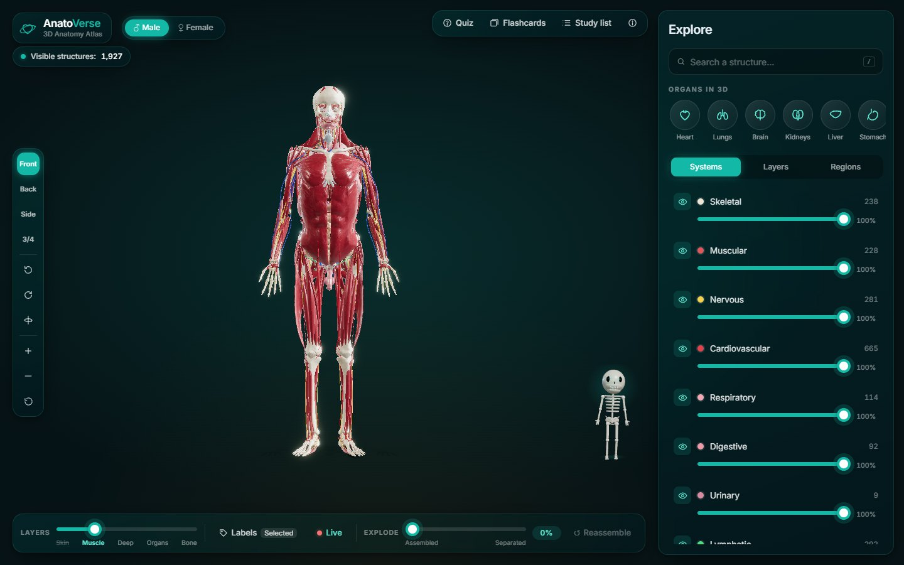
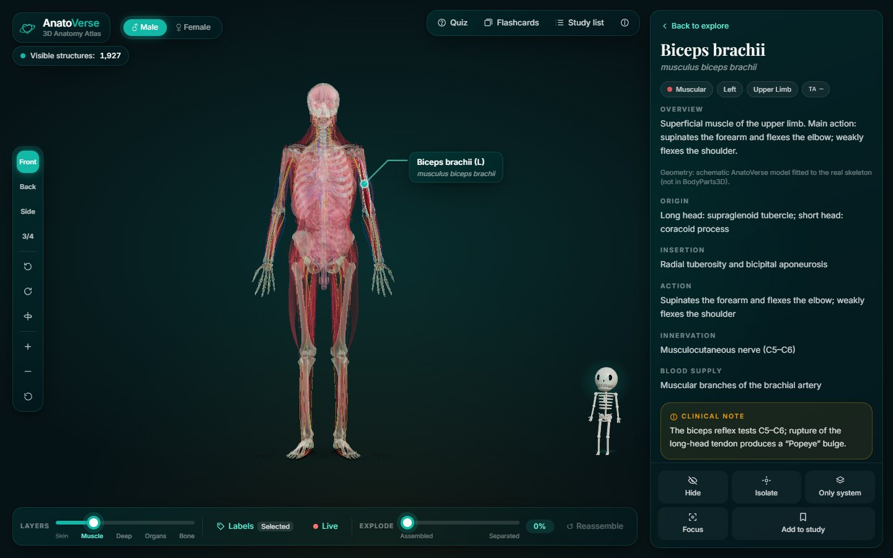
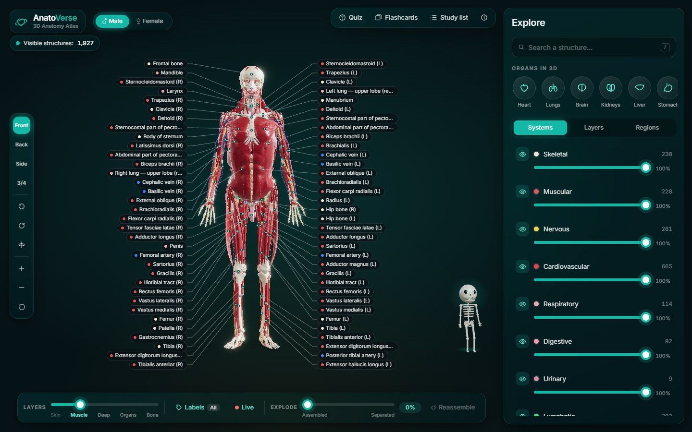
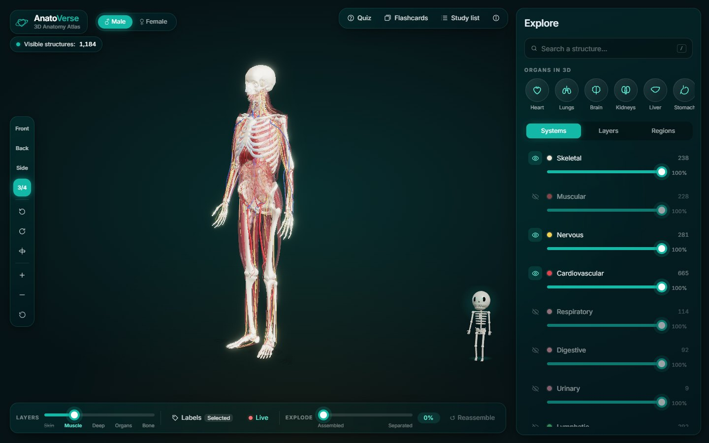
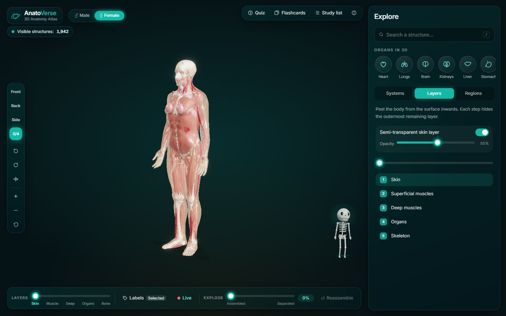
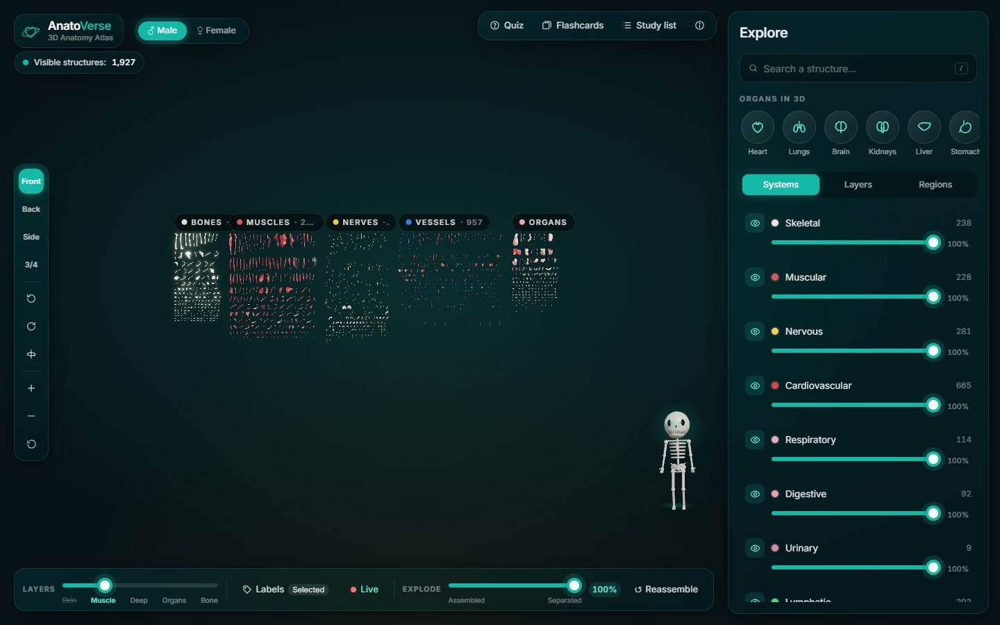
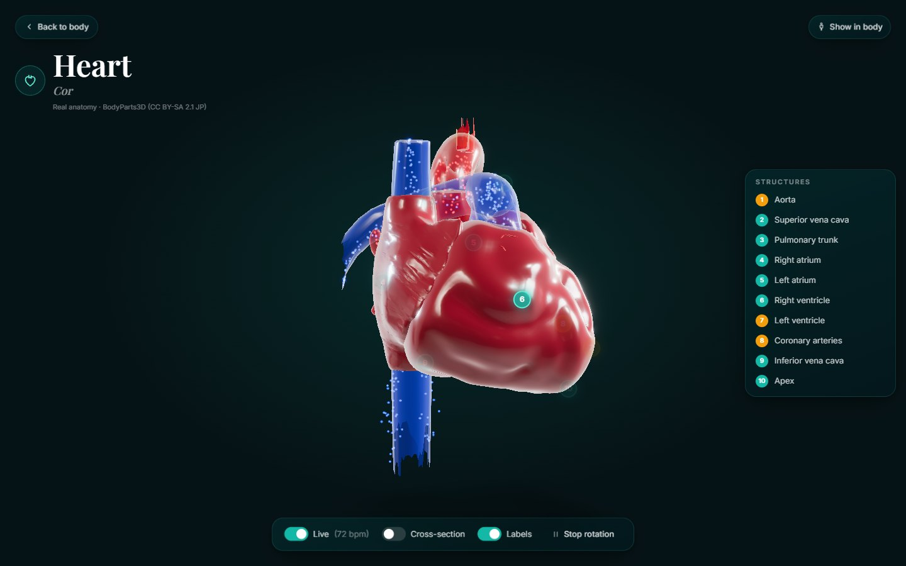
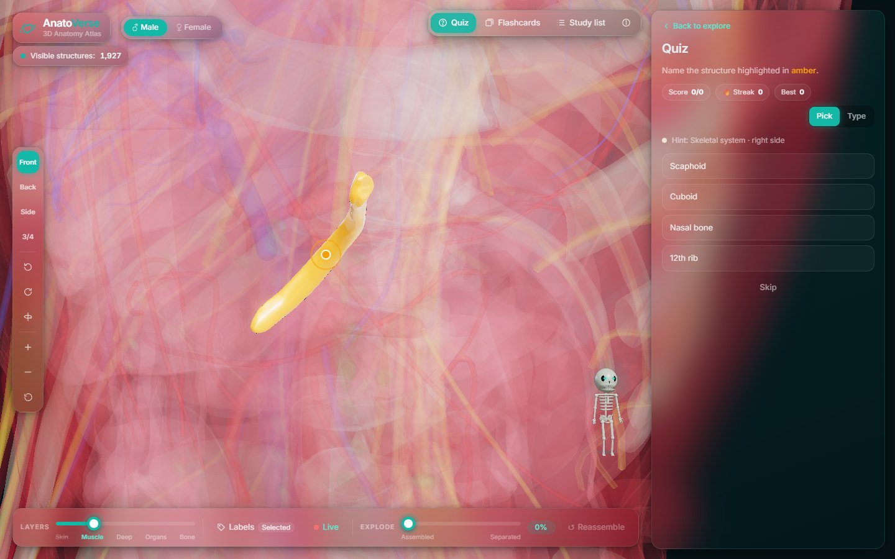
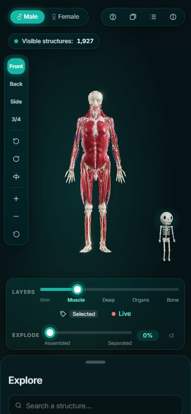

# AnatoVerse

**Explore every structure of the human body in 3D.** An interactive 3D anatomy atlas for medical and nursing students. It runs in the browser on desktops (mouse and keyboard), tablets and phones (touch).



React · TypeScript · Vite · three.js / @react-three/fiber / drei · Zustand · Framer Motion · Fuse.js · Tailwind CSS

## Screenshots

### Full-body explorer
The main screen (above) shows a complete human body of about 1,900 separate structures, built from real anatomy scans (BodyParts3D). Every bone, muscle, nerve, vessel and organ is its own piece you can click.

- **Left rail:** Front, Back, Side and ¾ views, rotate left/right, a slow turntable spin, zoom and reset.
- **Header:** the Male / Female switch.
- **Bottom bar:** the **Layers** slider peels the body from the outside in (Skin → Muscle → Deep → Organs → Bone). Next to it are name labels, the **Live** switch (breathing and heartbeat) and the **Explode** slider.
- **Explore panel (right):** search, quick links to the organ models, and the system list.

### Click any structure to learn about it


Click (or tap) a structure, or find it with the search box. It gets a glowing outline and a name tag, and everything else fades to a see-through "ghost" so you can see where it sits. The info card on the right shows:

- the English and Latin names
- origin, insertion, action, nerve supply and blood supply (for muscles)
- a clinical note
- buttons to **Hide**, **Isolate**, show **Only this system**, **Focus** the camera, or **Add to study** list

Double-click empty space to go back to the whole body.

### Name labels for every part


Turn on **Labels → All** (or press `L`) and every part facing the camera gets a name tag with a leader line. Labels are arranged in two neat columns so they never overlap. You can also label only the selected part or one group (bones, muscles, nerves, vessels or organs).

### Show or hide whole body systems


In the **Systems** tab each body system has an eye button that fades it in or out, and its own opacity slider. Here only the skeleton, nerves and blood vessels are shown, seen from the ¾ view.

### Female body with a see-through skin layer


Switch to **Female** in the header. The **Layers** tab has a semi-transparent skin layer with its own opacity slider, so you can see the muscles and organs underneath.

The female body is the same real anatomy reshaped by a landmark-guided morph (narrower shoulders, wider pelvis, smaller height). Its female reproductive organs are AnatoVerse models fitted into the pelvis. No open, layered scan of a real female body was available.

### Explode view


Drag the **Explode** slider:

- **0 to 60%:** the parts move outward from the centre of the body.
- **60 to 100%:** they line up into a "parts catalogue", grouped as bones, muscles, nerves, vessels and organs and sorted by size.

Zoom in to read each part's name. Press **Reassemble** (or `R`) to put the body back together.

### Organ deep-dive


Open the heart, lungs, brain, kidneys, liver, stomach or eye from **Organs in 3D**. Each organ:

- **Spins slowly** until you touch it.
- **Has numbered pins** for its main parts, with a list on the right.
- **Has a Live switch:** the heart beats at 72 bpm with blood flowing, the lungs breathe, and so on.
- **Has a Cross-section switch** that cuts it open to show the inside.

### Quiz yourself


**Quiz** highlights a structure in amber and asks you to name it. You can pick from four options or type the name; English or Latin both count. It tracks your score and streak. **Flashcards** and the **Study list** use the parts you saved with *Add to study*.

### Works on phones


On a phone the controls get smaller, and the Explore panel and info cards become a sheet you swipe up from the bottom.

### Skelly, the AI anatomy tutor
Skelly is the little 3D skeleton in the bottom-right corner. Tap it and ask a question by typing or speaking, in English or Hindi (for example *"What does the femur do?"* or *"हृदय कैसे काम करता है?"*).

- **Answers:** Skelly replies in a few simple sentences and reads them aloud.
- **Show me:** a button flies the camera to the structures in the answer.
- **Needs an AI key:** set it up as shown in step 4 below.

## Getting started (step by step)

1. **Install [Node.js](https://nodejs.org)** version 23.6 or newer.
2. **Download the code:**
   ```bash
   git clone https://github.com/bikash880/AnatoVerse.git
   cd AnatoVerse
   ```
3. **Install the packages:**
   ```bash
   npm install
   ```
4. **(Optional) Give Skelly an AI key.** Copy `.env.example` to a new file called `.env`, then put **one** key in it:
   - **Free:** create a Google Gemini key at [aistudio.google.com](https://aistudio.google.com) → *Get API key*, and set `GEMINI_API_KEY=...`
   - **Paid:** create a Claude key at [console.anthropic.com](https://console.anthropic.com) → *API Keys*, and set `ANTHROPIC_API_KEY=...`

   The key stays on your computer's server and is never sent to the browser. `.env` is not uploaded to GitHub.
5. **Start the app:**
   ```bash
   npm run dev
   ```
6. **Open the app** at **http://localhost:5173** in Chrome or Edge. To use it on a phone or tablet on the same Wi-Fi, open the *Network* address that the terminal prints.

Other commands:

```bash
npm run build      # type-check + production build into dist/
npm start          # serve the production build and the Skelly API together
npm run validate   # builds every structure for both sexes; checks geometry and that hand/foot bones connect
npm run build:models  # (optional) rebuild the real BodyParts3D anatomy into public/models/ (see below)
```

## Features

- **Full Body Explorer.** Every structure is its own mesh. Systems load lazily and the "Visible structures" badge updates live. Materials use clearcoat and sheen, with studio lighting and contact shadows.
- **Explode view.** From 0 to 60% the parts move radially out from the body centre. From 60 to 100% they glide into a flat parts-catalogue grid that faces the camera, grouped as bones, muscles, nerves, vessels and organs and sorted by size. Positions are written straight to meshes in `useFrame`, so no React render happens per mesh.
- **Select & inspect.** Hovering shows an outline. Clicking or tapping selects a structure: it glows in the accent colour, every other mesh turns into a translucent ghost, and a floating label with a leader line appears. The info card shows the overview, origin, insertion, action, innervation, blood supply, a clinical note, and buttons for Hide, Isolate, Only this system, Focus and Add to study list.
- **Explore panel.** Fuzzy search over English and Latin names. Shortcuts open the organs. Tabs: Systems (switches with counts), Layers (a depth peel from skin to skeleton) and Regions.
- **Organ Deep-Dive** for the heart, lungs, brain, kidneys, liver, stomach and eye. Each opens a high-detail model that auto-rotates until touched. It has numbered hotspot pins that are snapped to the surface and fade when hidden behind the organ, an Animate toggle (heartbeat, breathing and others), a Cross-section clipping plane that reveals inner structures, and a labels toggle.
- **Study tools.**
  - Quiz: an amber target with a pulsing marker. Pick from options or type the name (fuzzy-matched against English and Latin). Tracks score, streak and best streak.
  - Study list: saved in localStorage.
  - Flashcards: built from the study list.
- **Male / Female** switch in the header.
- **Explore panel:** each system has an eye toggle (systems fade in and out) and its own opacity slider. The Layers tab has the semi-transparent skin toggle with an opacity slider.
- **Camera:** clicking a structure gives it a pulsing glow outline, opens its info card and flies the camera to it. Double-click empty space to deselect and reset the view. Hovering shows the name next to the cursor. The left rail has Front / Back / Side / 3/4 views, rotate left/right, a turntable toggle, zoom and reset.
- **Bottom bar:** a layer peel slider (Skin → Muscle → Deep → Organs → Bone), labels, Live and explode.
- **Responsive layout.** Phones get a swipe-up bottom sheet and a compact dock.
- **Name labels** (dock → Labels, or `L`): Off / Selected only / Group / All, plus a one-group filter.
  - On the assembled body, labels go into left and right callout columns with leader lines and no overlaps. Front view labels front-facing parts, Back view back-facing ones, and hidden parts are skipped. Visibility comes from one low-res ID-buffer render each time the camera settles, so labelling stays cheap at 60 fps.
  - In the 100% grid, each part's name appears under it once you zoom in far enough to read it.
  - Hover or tap a label for its Latin name.
- **Keyboard shortcuts:** `1–5` camera views · `E` explode · `R` reassemble · `F` focus · `L` labels · `Esc` deselect · `/` search.

## Skelly — AI anatomy tutor

Skelly is the small animated 3D skeleton in the bottom-right corner. Tap it to open the chat, then type or speak a question in English or Hindi, e.g. "What does the femur do?" or "हृदय कैसे काम करता है?".

- **Answers:** Google Gemini (free tier) or Claude replies in 3–5 sentences, in the language you asked in. The structure you have selected is sent along as context.
- **Linked to 3D:** each answer also returns the structures it is about. They are matched to the model, the first one is highlighted and the camera flies to it, and every match gets a **Show me** button.
- **Voice:**
  - Input: a mic button using the Web Speech API, with an **EN / हिंदी** switch (en-IN / hi-IN).
  - Output: `speechSynthesis` speaks each answer with an en-IN or hi-IN voice at pitch 0.8 and rate 0.95. The jaw moves in time and a sound-wave shows while it speaks, with mute, stop and per-answer replay buttons.
  - Voice input works in Chrome and Edge. The available voices depend on the operating system.
- **Extras:** suggestion chips (Explain this part · Quiz me · Clinical importance). Chat history lasts for the browser session. On phones the panel opens as a bottom sheet.

**Setup.** The API key stays on the server and is never sent to the browser.

```bash
cp .env.example .env        # then put ONE key in .env:
                            #   GEMINI_API_KEY=...         free tier, from aistudio.google.com → Get API key
                            #   ANTHROPIC_API_KEY=sk-ant-… Claude (paid), used when both are set
npm run dev                 # starts the Skelly API (server/skelly.ts, port 8787) and Vite together
npm run build && npm start  # production: one Node server serves dist/ and /api/skelly/chat
```

`server/skelly.ts` is a small Node HTTP route with no framework:

- **Input:** it validates and limits input, sends the last 24 turns of history, and asks for structured JSON output (`answer` + `structures`).
- **Gemini:** it calls the Gemini REST API. If one model is retired, busy or rate-limited, it tries the next one, and each request times out after 30 s.
- **Claude:** it uses the official `@anthropic-ai/sdk` at low effort, with server-side refusal fallback.
- **Errors:** it maps errors to friendly messages. Without a key, Skelly explains in the chat how to add one.

## Architecture

```
src/
  anatomy/            procedural reference model
    landmarks.ts      skeletal landmarks every system is positioned from
    geometry.ts       spindle / long-bone / tube / blob / ribbon builders, female body warp
    systems/*.ts      one builder per body system (metadata + lazy geometry)
    catalog.ts        merges builders + src/data/structures.json overrides; search index source
  three/
    meshRegistry.ts   owns all THREE.Mesh objects; lazy per-system loading (procedural or GLB)
    BodyModel.tsx     visibility/material state, picking, explode animation
    explode.ts        radial + parts-grid layout
    cameraRig.ts      eased camera moves, presets, view offset for the UI insets
    organModels.ts    high-detail Deep-Dive organs
    SceneOverlays.tsx hover outline, selection label, quiz marker, grid labels, controls
  components/         AppShell, BodyExplorer, ExplorePanel, InfoCard, ControlDock, OrganViewer,
                      Hotspot, StudyModes (Quiz/Flashcards/Study list), LoadingScreen, CreditsModal
  store/useAtlasStore.ts  Zustand store (selectedId, visibleSystems, layerDepth, explodeValue,
                          viewPreset, sex, studyList, quizState, …); study list persisted
  data/               systems.ts, structures.json (curated records), organs.json (hotspots)
```

The data model follows the spec. `structures.json` holds curated records that override the generated text, matched by `id`. Use **About & Credits → Export structures.json** to download the full catalogue (~1,180 records) in the same format. `organs.json` holds the organ hotspots.

## Real anatomy models (BodyParts3D)

```bash
npm run build:models   # downloads BodyParts3D (~65 MB, cached in .cache/) and writes public/models/
```

`scripts/build-models.ts` converts the 1,258 BodyParts3D 4.0 "part-of" meshes (© DBCLS, **CC BY-SA 2.1 JP**) into Draco-compressed GLBs. The output is about 9.7 MB for the male body, split into one file per system and loaded lazily with a progress bar, plus 3.4 MB for seven organ models.

The script does the following:

- **Matching:** maps BodyParts3D names to AnatoVerse structures, with synonyms and ordinals (for example, fifth thoracic vertebra matches the existing T5 vertebra). 451 meshes keep their curated facts. Every mesh records its FMA ID and source.
- **Reconstruction:** builds the parts the dataset lacks as smooth envelopes around real geometry:
  - lung lobes, around each lobe's real bronchial tree and segmental vessels
  - the ventricular myocardium, around the real ventricular cavities and coronary vessels
- **Fitted (schematic) parts:** fills the remaining gaps with AnatoVerse's own models: most muscles, peripheral and cranial nerves, spinal cord, lymph nodes, larynx, pharynx, parotid glands, sigmoid colon, caecum and male genital organs. These are warped onto the real skeleton with a 3-D thin-plate spline fitted to 94 landmarks measured on the real bones. The info card says which geometry is real, reconstructed or schematic.
- **Organs:** builds the seven organ models with hotspots re-anchored on the real parts. Two kidney hotspots, renal pyramids and renal pelvis, were dropped because the dataset has no internal kidney structure.
- **Compression:** simplifies body meshes with meshoptimizer, then applies Draco compression. A local Draco decoder is served from `public/draco/`, so no CDN is needed at runtime.

**Female body.** BodyParts3D is a single male body, and no open layered female dataset could be bundled (Z-Anatomy needs Blender to export; NIH 3D and Sketchfab need accounts or tokens). The script therefore derives the female body from the same real anatomy with a second thin-plate-spline morph driven by the skeletal landmarks: about 6% shorter, narrower shoulders, clavicles and rib cage, a wider and shallower pelvis with a wider subpubic arch, and a shallower body. Every layer goes through the same warp, so skin, muscle, organs and bone stay aligned. The male external genital skin is smoothed, a breast contour is added around the mammary glands, and AnatoVerse's female reproductive organs (uterus, ovaries, uterine tubes, vagina) are fitted into the morphed pelvis. Output: `public/models/female/`.

**Level of detail.** Meshes over 20k triangles also get a simplified copy (8%) stored as a `__lod` node; the app swaps to it when the structure covers fewer than ~140 px on screen. Instancing is not used: every structure is a unique shape and must stay individually pickable, so there is no repeated geometry to instance.

**Rendering:**
- **Materials:** BodyParts3D meshes have no UVs, so tissue detail is generated in the shader from 3-D noise rather than image textures. This includes colour, bump and roughness, surface vessels, spongy lung, porous bone, the fibred iris and scleral vessels (`src/three/tissue.ts`). These are layered on MeshPhysicalMaterial with clearcoat and sheen, and the cornea and lens use real transmission. KTX2 doesn't apply because no texture files are shipped.
- **Lighting:** CC0 Poly Haven studio HDRI, N8AO ambient occlusion, bloom, ACES Filmic tone mapping and contact shadows.
- **Performance fallback:** when the frame rate drops, AO turns off first, then the procedural tissue detail. `?quality=low` forces this mode for weak devices.

**Live** (switch in the dock and the organ viewer):
- **Heart:** atria then ventricles at 72 bpm, with blood particles along vessel centre-lines extracted from the real great vessels.
- **Lungs:** breathing at 14 per minute, with the diaphragm descending.
- **Brain:** neural pulses across the gyri.
- **Stomach:** peristalsis along its principal axis.
- **Kidneys:** renal and ureteric flow particles.
- **Liver:** moves with breathing.
- **Eye:** the pupil constricts and dilates, and the eye glances around.
- **Whole body:** subtle breathing and heartbeat.

## Notes

- Descriptive text and clinical notes are educational summaries. Terminologia Anatomica IDs are filled in only for a handful of structures. Verify them against TA2 and your course material.
- `?debug` in the URL exposes the camera rig on `window.__rig` for automated end-to-end checks.
